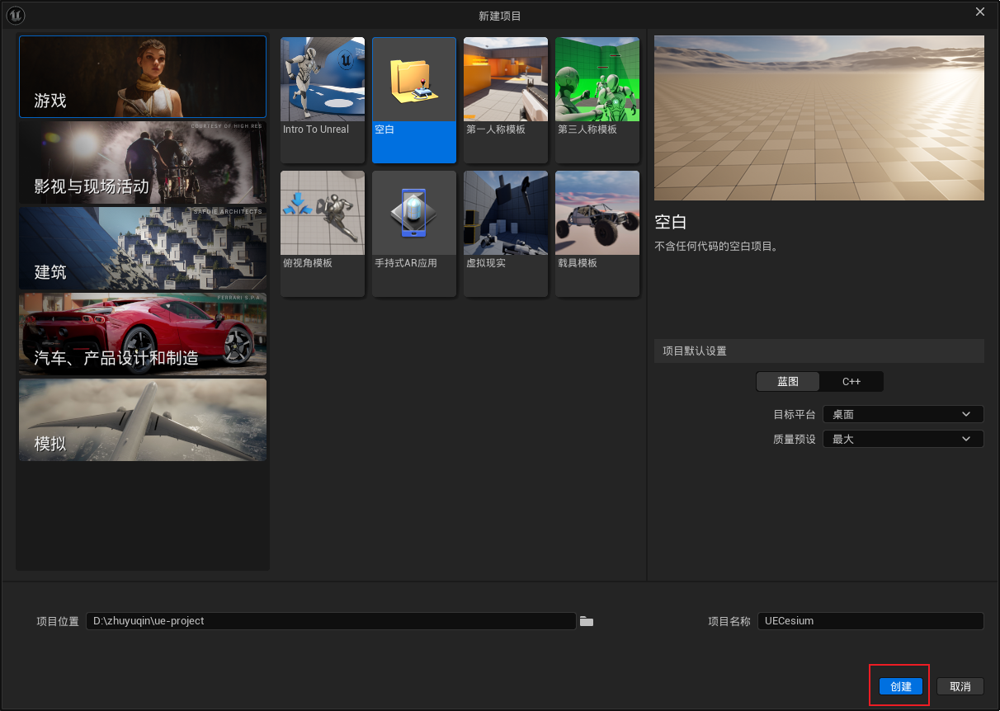
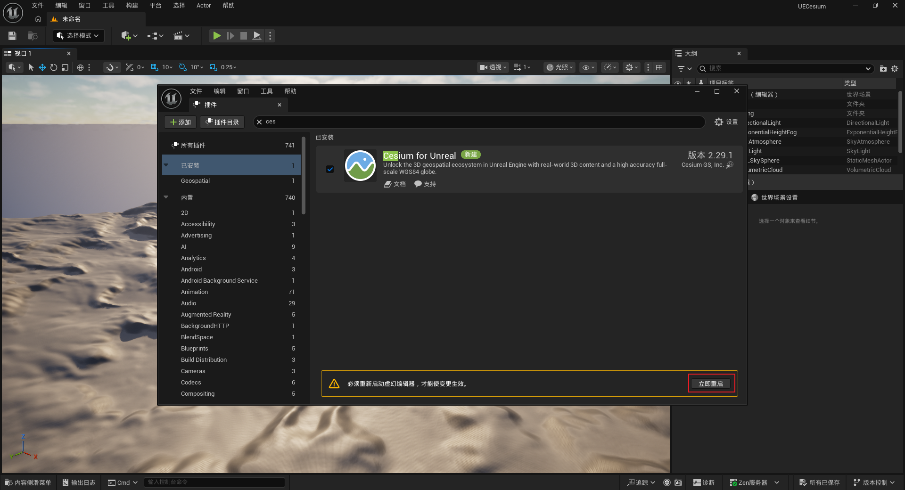
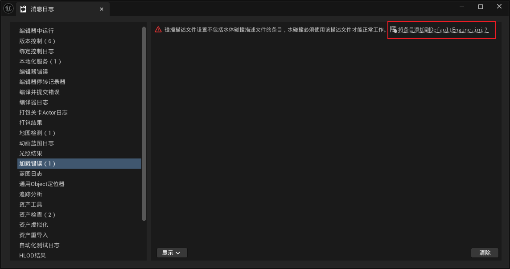
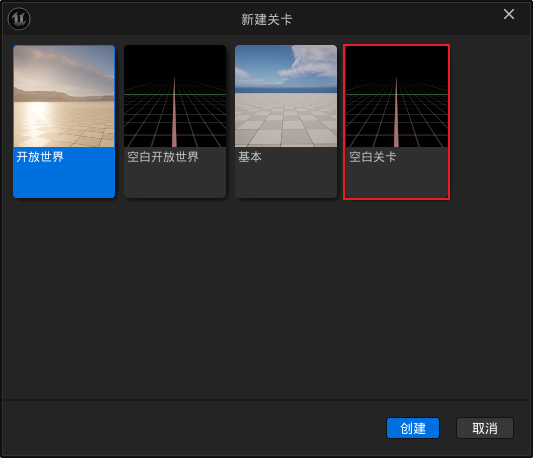
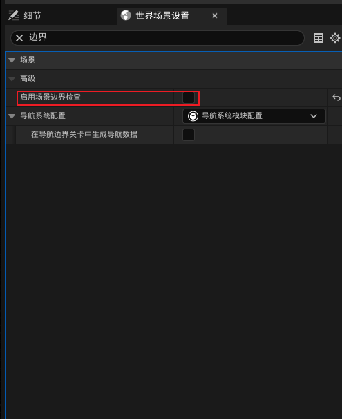
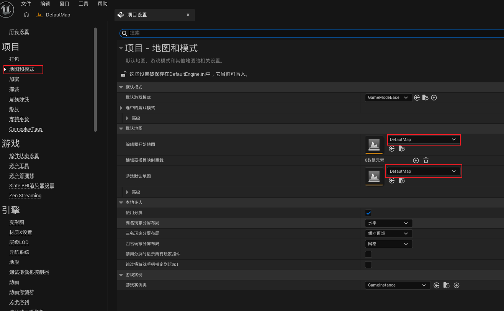
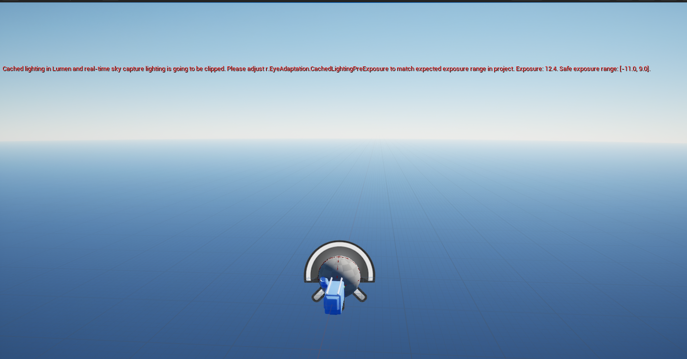

> 参考：https://cesium.net.cn/learn/unreal/unreal-quickstart

## 安装UE cesium插件


---

## 创建 Cesium for Unreal 项目

1. 启动 Unreal Engine 并创建一个新项目。选择“游戏”作为“新项目类别”，选择“空白”作为“模板”。
   
2. 项目完全加载后，激活 Cesium for Unreal 插件。打开“插件”窗口（编辑 -> 插件），然后在插件窗口顶部的搜索栏中搜索“Cesium”。确保插件旁边的复选框已勾选。启用插件后，需要重启 Unreal Engine。
   
3. 首次激活 Cesium for Unreal 插件并重启编辑器后，会看到与“水体碰撞配置文件”相关的错误。点击“将条目添加到 DefaultEngine.ini”链接进行修复。
   

## 准备项目和关卡

1. 创建一个新关卡（文件 -> 新建关卡）。出现提示时，选择“空关卡”，以确保关卡中没有任何对象。
   
2. 禁用“世界边界检查”。此选项位于“世界设置”（窗口 -> 世界设置）的“世界 -> 高级”类别中。
   > 在 UE5 + Cesium 项目中，关闭 「世界场景设置 → 启用场景边界检查（Enable World Bounds Checks）」，主要是为了防止 Cesium 的大范围地理场景触发UE 的世界边界保护机制，导致场景或物体被意外清理。
   >
   > 1. 这个选项到底干什么？
   >    UE 默认有一个世界边界范围。开启检查后，如果 Actor（场景对象）跑到了边界之外，UE 会执行边界检查，并可能销毁越界对象。
   >    Cesium 的地理场景和普通 UE 场景不一样：
   >
   > - 地理坐标范围大：地球场景可能涉及非常大的空间范围。
   > - 坐标会发生变化：Cesium 可以通过原点转换等机制，让地理位置映射到 UE 世界坐标。
   > - 部分对象可能越界：地形瓦片、3D Tiles、相机或其他对象可能被判断为超出世界边界。
   >   因此，关闭检查可以避免 UE 因边界判断而误删场景对象。
   >
   > 2. 不关闭会出现什么问题？
   >    常见表现：
   >
   > - 相机飞行到一定距离后，突然被拉回世界原点附近。
   > - Dynamic Pawn 无法继续靠近地面，像撞上了一堵看不见的墙。
   > - Pawn 被异常移动甚至销毁，导致相机位置错乱。

 3. 通过点击“窗口 -> Cesium”打开“Cesium”面板。添加SunSky,Dynamic Pawn
 4. 保存关卡到磁盘(ctrl+s)，并将当前关卡初始化为默认关卡(编辑 -> 项目设置 -> 项目 -> 地图和模式)


---

## 设置参数解决报错

1. 解决CesiumSunSky场景报错

打开 UE 项目的 Config/DefaultEngine.ini，在文件末尾添加
```ini
[/Script/Engine.RendererSettings]
r.EyeAdaptation.CachedLightingPreExposure=8
```