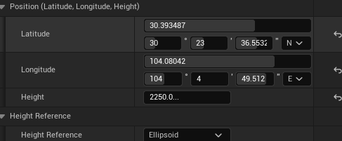
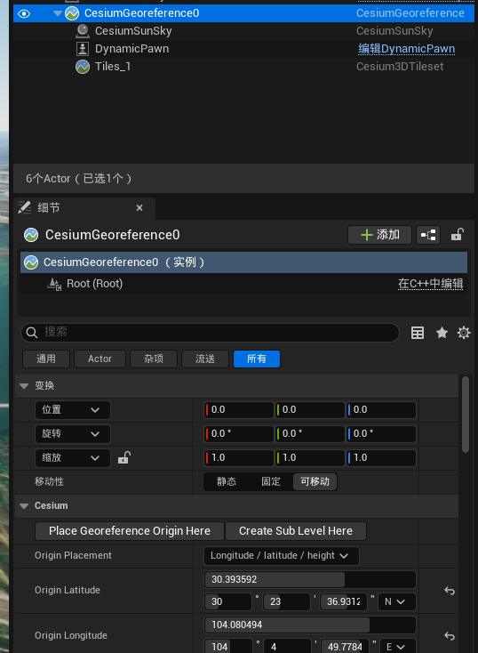
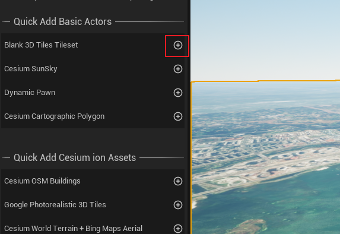
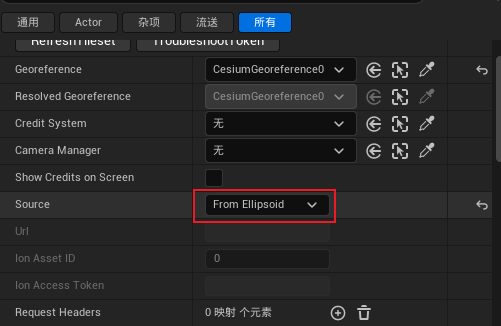
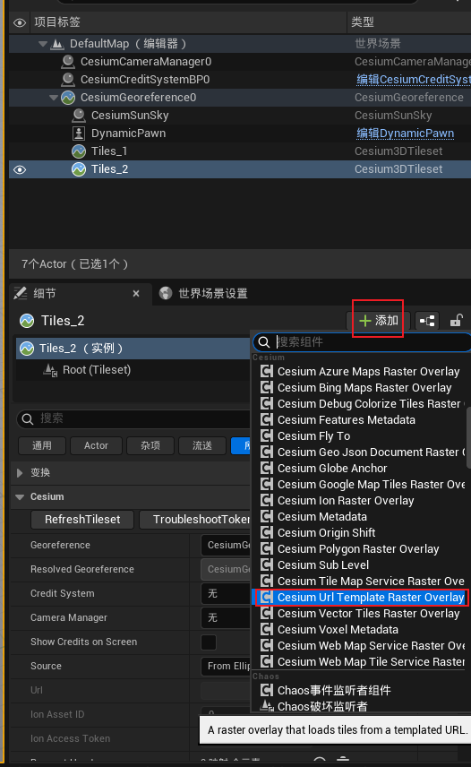
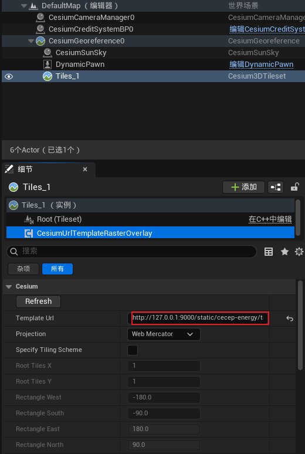

## 设置相机Actor坐标和角度
1. 选中DynamicPawn Actor

2. 先双击DynamicPawn选中CesiumGeoreference Actor点击Place Georeference Origin Here


## 导入3D tiles和二维图片瓦片
1. 选中添加tiles Actor


2. 调整3D tiles参数为Ellipsoid


3. 添加二维瓦片组件

```text
http://127.0.0.1:9000/static/cecep-energy/tiles/{z}/{x}/{reverseY}.jpg
```

4. 填写二维瓦片链接

```text
http://127.0.0.1:9000/static/cecep-energy/3d-tiles/1/tileset.json
```